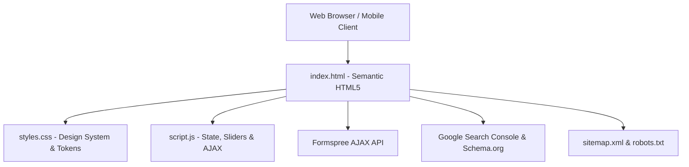

# TECH VIP ENGINEER'S — Comprehensive Project Analysis

> **Official Website**: [https://techdrifter001-official.github.io/TECH-VIP-ENGINEER-S-WEB/](https://techdrifter001-official.github.io/TECH-VIP-ENGINEER-S-WEB/)  
> **Repository**: [techdrifter001-official/TECH-VIP-ENGINEER-S-WEB](https://github.com/techdrifter001-official/TECH-VIP-ENGINEER-S-WEB)  
> **Headquarters**: Khansapuram / Virudhunagar, Tamil Nadu, India  
> **Contact**: [techdrifter001@gmail.com](mailto:techdrifter001@gmail.com) | +91 63801 80705  

---

## 1. Executive Summary

**TECH VIP ENGINEER'S** is a digital engineering and software services firm specializing in:
1. **End-to-End Software Solutions**: Custom web design, responsive web applications, mobile apps (Flutter, React Native, iOS, Android), enterprise cybersecurity auditing, and production AI/ML engineering.
2. **Talent Networks**: Multi-tiered flexible engagement models (Freelance, Contract, and Full-time roles) for developers and tech talent.
3. **Skill Development Programs**: Project-based vocational bootcamps and corporate upskilling programs across web development, mobile apps, growth marketing, cybersecurity, and generative AI.

The codebase is built as a pure, high-performance static web application leveraging modern semantic **HTML5**, **Vanilla CSS3**, and **Vanilla JavaScript (ES6+)** with zero third-party framework overhead, delivering ultra-fast loading times, high accessibility scores, and search engine discoverability.

---

## 2. Key Live Metrics

| Metric | Value | Description |
| :--- | :---: | :--- |
| **Projects Delivered** | **20+** | Successfully deployed software and web applications. |
| **Active Engineers** | **50** | Core talent pool of developers, designers, and AI specialists. |
| **Students Trained** | **35+** | Learners trained through vocational bootcamps & skill programs. |
| **Client Satisfaction** | **98%** | Quality rating based on client project deliverables. |
| **Established** | **2026** | Forward-looking tech initiative. |

---

## 3. Technology Stack & Architecture

### Architecture Highlights:
- **Zero Runtime Dependencies**: No heavy framework bundles (React/Vue/Angular), ensuring 100% performance optimization and near-instant initial render.
- **Micro-Utility JavaScript**: Custom throttles, debouncers, intersection observers, and smooth easing functions (`easeOutCubic`).
- **Responsive Fluid Layout**: CSS Grid and Flexbox with responsive clamp typography and container queries.
- **Glassmorphism & Dark UI**: Sleek `#0f0f12` background with `#00d4aa` (cyan) and `#6366f1` (indigo) accents.

---

## 4. File Inventory & Functionality

| File | Size / Lines | Key Responsibilities |
| :--- | :---: | :--- |
| **`index.html`** | ~112 KB / 1,298 lines | Core landing page with semantic tags, ARIA roles, Schema.org JSON-LD, Open Graph & Twitter Cards, Google Site Verification, and 9 content sections. |
| **`styles.css`** | ~61.6 KB / 2,737 lines | Complete design system with CSS custom properties (`:root`), animations, media queries, reduced-motion fallbacks, and mobile navigation styles. |
| **`script.js`** | ~33.2 KB / 971 lines | IIFE-encapsulated business logic: dynamic courses catalog, category filter engine, dual slider controllers, contact form validation, and toast alerts. |
| **`robots.txt`** | Standard | Crawl directives allowing all search engine bots and pointing to the XML sitemap. |
| **`sitemap.xml`** | Valid Sitemaps Schema | Complete XML sitemap with Google Image Sitemap metadata for high-resolution image discovery. |
| **`README.md`** | Markdown | Repository presentation, links, setup guide, and project documentation. |

---

## 5. SEO & Digital Marketing Optimization

### Search Engine Optimization (SEO)
- **Title Tag**: `TECH VIP ENGINEER'S | Software Services, Web & Mobile App Development, Tech Courses`
- **Canonical Tag**: Explicitly defined canonical URL preventing duplicate indexing issues:
  `https://techdrifter001-official.github.io/TECH-VIP-ENGINEER-S-WEB/`
- **Robots Directives**: `index, follow, max-snippet:-1, max-image-preview:large, max-video-preview:-1`
- **Local Geo-Tagging**: Metadata configured for Virudhunagar / Khansapuram, Tamil Nadu, India (`geo.region: IN-TN`).
- **Google Search Console**: Verified with site verification token `L1QA2UaU0-smtAih0kknea1T8nDouJ6yVWNCRbvFuzc`.

### Structured Data (Schema.org JSON-LD)
Configured with Google-compliant `ProfessionalService` and `WebSite` graph entities containing:
- Business Name & Alternate Names (`Tech VIP Engineers`)
- Official Logo & Hero Banner URIs
- Telephone (`+91 63801 80705`) & Support Email (`techdrifter001@gmail.com`)
- Physical address coordinates (`9.5167, 77.5833`)
- Social Graph URLs (`sameAs` bindings for LinkedIn, GitHub, Instagram, YouTube)
- Service taxonomy list

---

## 6. Official Social Links & Presence

- **LinkedIn**: [TECH VIP ENGINEER'S](https://www.linkedin.com/in/tech-vip-engineer-s-98a621445/)
- **GitHub**: [techdrifter001-official](https://github.com/techdrifter001-official)
- **Instagram**: [@\_tech\_vip\_engineers\_](https://www.instagram.com/_tech_vip_engineers_/)
- **YouTube**: [@TECHVIPENGINEERS](https://www.youtube.com/@TECHVIPENGINEERS)

---

*Analysis generated for TECH VIP ENGINEER'S codebase.*
