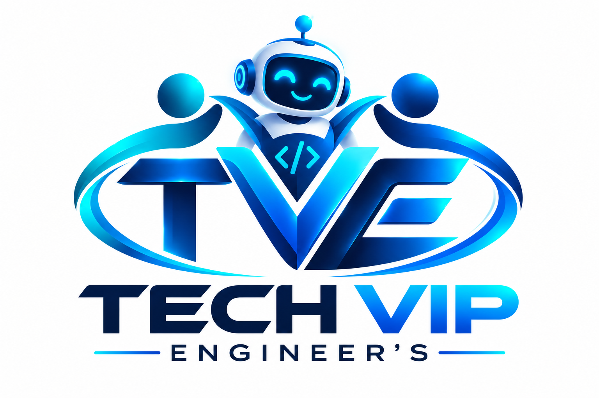

# 🚀 TECH VIP ENGINEER'S WEB

<p align="center">
  
</p>

<p align="center">
  <strong>Building Digital Experiences That Matter • Empowering Talent • Growing Careers</strong>
</p>

<p align="center">
  <a href="https://techdrifter001-official.github.io/TECH-VIP-ENGINEER-S-WEB/"></a>
  <a href="https://github.com/techdrifter001-official/TECH-VIP-ENGINEER-S-WEB"></a>
  <a href="PROJECT_ANALYSIS.md"></a>
</p>

---

## 🌐 Live Website

🔗 **Access the official website**:  
**[https://techdrifter001-official.github.io/TECH-VIP-ENGINEER-S-WEB/](https://techdrifter001-official.github.io/TECH-VIP-ENGINEER-S-WEB/)**

---

## 📊 Live Metrics & Impact

- 🚀 **Projects Delivered**: `20+`
- 👨‍💻 **Active Engineers**: `50`
- 🎓 **Students Trained**: `35+`
- ⭐ **Client Satisfaction**: `98%`

---

## 🛠️ Core Services

1. **Web Design & Development**: Modern, high-performance responsive web applications using clean architectures.
2. **Mobile App Development**: Cross-platform & native iOS/Android applications (Flutter, React Native, Swift).
3. **Digital Marketing & Growth**: SEO, brand strategy, paid advertising, and conversion rate optimization.
4. **Cybersecurity Services**: Penetration testing, vulnerability assessments, security audits, and compliance.
5. **AI Engineering & ML Solutions**: Custom ML pipelines, LLM integration, MLOps, and intelligent systems.
6. **Talent Networks & Training**: Freelance, contract, and full-time hiring models along with industry-ready skill courses.

---

## 🏗️ Technology Stack

- **Frontend Core**: Semantic HTML5, Vanilla Modern CSS3, Modular ES6+ JavaScript.
- **Design System**: Custom CSS properties (`:root`), glassmorphism, responsive grid systems, and dark theme palette.
- **SEO & Discoverability**: Schema.org JSON-LD Structured Data, Google Search Console verification, XML Sitemap with image tags, and `robots.txt`.
- **Forms & Integration**: Formspree asynchronous AJAX submissions with toast alerts and client-side validation.

---

## 📁 Repository Structure

```text
├── index.html                           # Main landing page & SEO metadata
├── styles.css                           # Design system, styling & animations
├── script.js                            # Interactive logic, sliders & form handlers
├── robots.txt                           # Search engine indexing directives
├── sitemap.xml                          # Search engine XML sitemap
├── PROJECT_ANALYSIS.md                  # Comprehensive technical project analysis
├── README.md                            # Project overview & documentation
├── logo.png                             # Official brand logo
├── Tech VIP Engineering Team.png        # Team leadership graphic
└── Collaborative Tech Team at Work.png  # Collaborative engineering graphic
```

---

## 📑 Full Analysis

For a detailed technical breakdown of the architecture, design system, and SEO strategy, see:  
👉 **[PROJECT_ANALYSIS.md](PROJECT_ANALYSIS.md)**

---

## 📬 Contact & Connect

- **Email**: [techdrifter001@gmail.com](mailto:techdrifter001@gmail.com)
- **Phone**: +91 63801 80705
- **LinkedIn**: [TECH VIP ENGINEER'S](https://www.linkedin.com/in/tech-vip-engineer-s-98a621445/)
- **Instagram**: [@\_tech\_vip\_engineers\_](https://www.instagram.com/_tech_vip_engineers_/)
- **YouTube**: [@TECHVIPENGINEERS](https://www.youtube.com/@TECHVIPENGINEERS)

---

&copy; 2026 **TECH VIP ENGINEER'S**. All rights reserved.
